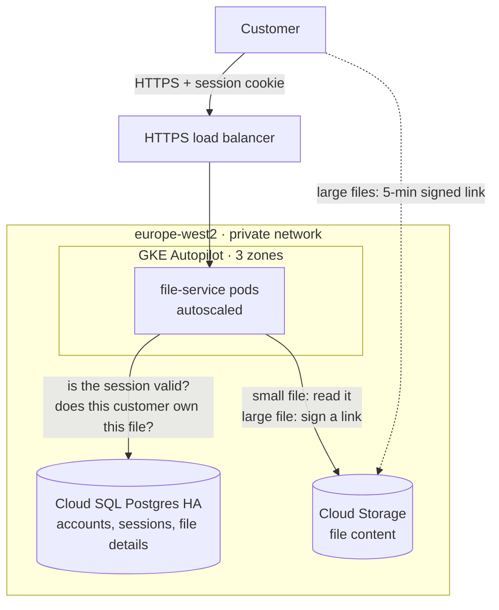

# Customer File Retrieval Service — Platform Engineer exercise

A service that lets customers download their own files, running on Google Cloud:
**GKE Autopilot + Cloud SQL + Cloud Storage**, behind an **HTTPS load balancer**. Cloud
resources are built with Terraform, Kubernetes objects with Helm, and the service is written
in Python (FastAPI).

| Stage | Where |
|---|---|
| 1. Architecture | [`docs/architecture-diagram.html`](docs/architecture-diagram.html) (diagram), [`docs/architecture.md`](docs/architecture.md) (what each piece does and why) |
| 2. Infrastructure | [`infra/platform`](infra/platform) (cloud resources, Terraform) and [`infra/helm/file-service`](infra/helm/file-service) (Kubernetes objects, Helm chart) |
| 3. Service | [`app/`](app) (code, tests, Dockerfile, load test) |
| Testing | [`docs/testing.md`](docs/testing.md) (unit, integration, smoke and load tests; how to run them) |

## Architecture at a glance



**Request path:** customer → load balancer → pod reads the session cookie and looks up the
session in Cloud SQL, which gives the customer id → looks up the file, filtered by that
customer id → small file: returns it; large file: redirects to a 5-minute signed link so
Cloud Storage serves it.

## Why each piece is there

| Component | Job | Why not something simpler |
|---|---|---|
| HTTPS load balancer | One public address, TLS, spreads traffic over healthy pods | Needed for HTTPS and multi-zone traffic at 6k req/s |
| GKE Autopilot (regional) | Runs the containers in 3 zones; Google manages nodes | Standard GKE means managing node pools ourselves |
| Cloud SQL (HA) | Accounts, sessions, file details and ownership: fast, indexed lookups | A database pod means running failover and backups ourselves |
| Cloud Storage | The file content | A Compute Disk mounts on one node in one zone only |
| Cloud Monitoring | SLOs, alerts, logs, metrics | Built in; no extra tooling to run |

Why both a database and a bucket? The bucket stores the **bytes**; the database stores
**facts about the bytes** (owner, name, size, status). Checking "does customer X own file Y?"
or "list X's files, newest first" is one indexed query in Postgres, but slow and awkward
with bucket listings. See `docs/architecture.md` for the full reasoning.

## Authentication

The service does its own login with **username and password**. It does **not** use JWTs or
an external identity provider.

* `POST /auth/login` checks the password against an **scrypt** hash. Unknown users and wrong
  passwords get the same error, and the check takes the same time either way.
* On success the service creates a random **opaque session token** (256 bits) and sets it as a
  cookie: `HttpOnly`, `Secure` (outside local/test), `SameSite=Lax`, valid for 12 hours.
  The database stores only the token's **SHA-256 hash**.
* Every API call looks up the session in Postgres to find the customer id. Every file query
  is filtered by that customer id, so another customer's file returns 404.
* `POST /auth/logout` deletes the session on the server, so a copied cookie stops working
  immediately.
* There is **no self sign-up**. An administrator creates accounts with admin database rights
  (see Deploy, step 4). The app's own database login can only read accounts.
  `python -m file_service.create_user` does the same against any database you can reach
  with an admin connection string, for example the integration-test Postgres.
* **Browser page:** `https://<domain>/login` has a login form and lists the customer's files
  with download links. It's a static page that calls the same JSON API. It writes server data
  only as text, never HTML, and is served with a strict Content-Security-Policy: no inline
  code, no third-party resources, no framing. `/auth/login` itself stays a JSON API, so
  opening it directly in a browser still returns 405.

Why sessions instead of JWTs: sessions can be revoked on logout, and the service runs without
any external identity service. The trade-off is one indexed database lookup per request.
Moving to an external identity provider (OIDC/JWT) is listed under "Future improvements".

## API

| Method and path | Auth | Purpose |
|---|---|---|
| `GET /` | none | Static welcome page (the same nginx page as Stage 2) |
| `GET /login` | none | Browser page: login form, then the customer's files with download links |
| `POST /auth/login` | none | `{"username", "password"}` → sets the `fs_session` cookie |
| `POST /auth/logout` | cookie | Revokes the session |
| `GET /v1/files?limit=50` | cookie | The customer's available files, newest first (1–200) |
| `GET /v1/files/{file_id}` | cookie | Details of one file |
| `GET /v1/files/{file_id}/content` | cookie | Files up to 1 MiB are returned directly; larger files get a 302 to a 5-minute signed link |
| `GET /healthz`, `/readyz`, `/metrics` | none | Liveness, readiness (checks the database), Prometheus metrics |
| `GET /docs` | none | Swagger UI. Turned off when `environment=prod` |

File ids must match `^[A-Za-z0-9_-]{8,64}$`, so path traversal and injection strings are
rejected before any lookup.

## Capacity and SLOs

* **6,000 req/s:** assuming ~300 req/s per 1-vCPU pod (to be measured with the load test),
  about 20 pods are needed. If one of three zones fails we lose a third, so production should
  run **30 pods minimum** (10 per zone), autoscaling up to 100. The chart defaults to
  `minReplicas: 6` to keep the dev environment cheap; set `--set autoscaling.minReplicas=30`
  for production.
* **The brief asks for 99.99%** success and 99.99% of responses under 300 ms. **The code
  currently targets 99.9%**: `availability_goal`/`latency_goal` default to `0.999` in
  Terraform, and the k6 thresholds are `p(99.9)<300` and `rate<0.001`. The reason is that
  this single-region design can't honestly promise 99.99%:
  * 99.99% allows about 4.3 minutes of full outage a month (99.9% allows about 43 minutes).
  * Cloud SQL Enterprise edition has a 99.95% SLA, and the whole service can't be more
    available than its database.
  * Getting to 99.99% needs Cloud SQL Enterprise Plus (99.99% SLA) or a second region
    (see "Future improvements").
  * To measure against 99.99% anyway, set `availability_goal = 0.9999` and
    `latency_goal = 0.9999` in `terraform.tfvars`, and change the k6 thresholds to
    `p(99.99)<300` and `rate<0.0001`.
* **Latency:** each request does one session lookup and one file lookup. File details are
  cached in each pod for 30 seconds. Each backend call times out after 250 ms and returns
  503 with `Retry-After`, so a slow dependency fails fast instead of piling up requests.
  These calls run one after another, so a request where every dependency is slow can still
  go over 300 ms. The k6 load test is the pass/fail check.

## Run locally

```bash
cd app
python -m venv .venv && . .venv/bin/activate     # Windows: .\.venv\Scripts\Activate.ps1
pip install -e ".[dev,gcp]"
pytest -q                                        # 31 unit tests
docker compose -f docker-compose.it.yml up -d --wait && pytest -m integration   # 22 integration tests

# Run the service with in-memory data and one demo account:
FS_ENV=local FS_LOCAL_USERNAME=demo FS_LOCAL_PASSWORD=demo-password-1 FS_LOCAL_CUSTOMER_ID=cust-1 \
  uvicorn file_service.main:create_app --factory --port 8080
# or with Docker (pass the same FS_LOCAL_* variables): docker compose up --build

curl -c cookies.txt -H 'content-type: application/json' \
  -d '{"username":"demo","password":"demo-password-1"}' http://localhost:8080/auth/login
curl -b cookies.txt http://localhost:8080/v1/files        # -> []  (the in-memory store starts empty)
```

Open http://localhost:8080/login to sign in as `demo` in the browser, or use Swagger UI at http://localhost:8080/docs. The `FS_LOCAL_*` demo account is refused in
`prod` and whenever Postgres is the backend.

## Deploy

```bash
# 1. Platform: network, GKE, Cloud SQL, bucket, load balancer pieces, monitoring, IAM
cd infra/platform
cp terraform.tfvars.example terraform.tfvars   # set project, a domain you control, alert email, your IP
terraform init -backend-config="bucket=<state-bucket>"
terraform apply
# Point the domain's DNS A record at `terraform output lb_ip_address`. The Google-managed
# certificate only becomes active once that record resolves publicly (15-60 min).
# With no domain, use <lb-ip-with-dashes>.sslip.io as the domain.

# 2. Stage 2: nginx welcome page (Helm)
cd ../..   # repo root
terraform -chdir=infra/platform output -json | jq '{platform: {
    fileServiceGsa: .file_service_gsa.value,   lbIpName: .lb_ip_name.value,
    certificateName: .certificate_name.value,  sslPolicyName: .ssl_policy_name.value,
    bucketName: .bucket_name.value,
    sqlConnectionName: .sql_connection_name.value,   dbIamUser: .db_iam_user.value,
    psaCidr: .psa_cidr.value }}' > platform.values.json
gcloud container clusters get-credentials "$(terraform -chdir=infra/platform output -raw cluster_name)" \
  --region europe-west2 --project <project>
kubectl apply -f infra/helm/namespace.yaml          # once: namespace + Pod Security labels
helm upgrade --install file-service infra/helm/file-service -n files \
  -f platform.values.json --set environment=dev --set domain=<domain> \
  --wait --atomic --timeout 15m                      # failed rollout -> automatic rollback
curl -I https://<domain>/

# 3. Stage 3: build the image, then deploy the real service (same command, two more values)
IMAGE="$(terraform -chdir=infra/platform output -raw image_repository)/file-service:<version>"
docker build -t "$IMAGE" app && docker push "$IMAGE"   # tags are immutable: new version each time
helm upgrade --install file-service infra/helm/file-service -n files \
  -f platform.values.json --set environment=dev --set domain=<domain> \
  --set appMode=file-service \
  --set image="<image repository>/file-service@sha256:<digest from docker push>" \
  --wait --atomic --timeout 15m
# rollback if needed: helm rollback file-service -n files

# 4. Database, once per environment. The app's own login can only READ accounts, so admin
#    work uses the built-in `postgres` user from a throwaway psql pod in the `default`
#    namespace (the `files` namespace denies all traffic by default).
INSTANCE="$(terraform -chdir=infra/platform output -raw sql_connection_name | cut -d: -f3)"
DB_USER="$(terraform -chdir=infra/platform output -raw db_iam_user)"
DB_IP="$(gcloud sql instances describe "$INSTANCE" --format='value(ipAddresses[0].ipAddress)')"
read -rsp "New postgres password: " PGPASSWORD; echo
gcloud sql users set-password postgres --instance "$INSTANCE" --password "$PGPASSWORD"
psql_admin() { kubectl run "psql-$RANDOM" --rm -i -n default --restart=Never \
  --image=postgres:16-alpine --env="PGPASSWORD=$PGPASSWORD" -- \
  psql "host=$DB_IP user=postgres dbname=files sslmode=require" -v ON_ERROR_STOP=1; }
psql_admin < app/db/schema.sql                                # tables + role file_service_app
echo "GRANT file_service_app TO \"$DB_USER\";" | psql_admin   # give the app its role

# Create a customer account: hash the password locally, then insert the row.
HASH="$(cd app && python -c 'import getpass; from file_service.auth import hash_password; print(hash_password(getpass.getpass("Password (12+ chars): ")))')"
echo "INSERT INTO users (username, customer_id, password_hash) VALUES ('alice', 'cust-1', '$HASH');" | psql_admin
# Add files: upload objects to the bucket and insert matching rows into `files`
# (uploads belong to another service; see Assumptions):
#   gsutil cp hello.txt gs://<bucket>/cust-1/hello.txt
#   INSERT INTO files (customer_id, file_id, object_key, filename, content_type, size_bytes)
#     VALUES ('cust-1', 'file-aaaa1111', 'cust-1/hello.txt', 'hello.txt', 'text/plain', 12);

# 5. Load test with the SLOs as pass/fail thresholds
k6 run -e BASE_URL=https://<domain> -e USERNAME=alice -e PASSWORD='<password>' \
  -e FILE_ID=<file id> app/loadtest/k6-slo.js
```

The chart's `values.schema.json` checks the values before anything is applied: `appMode`
must be `nginx` or `file-service`, `maxReplicas` must be at least 3, and the bucket, Cloud
SQL and database-user values are required in `file-service` mode. Keep the namespace
(`files`) the same as the platform stack's `k8s_namespace`, because Workload Identity is
bound to `files/file-service`.

Why Helm and not Terraform for the Kubernetes objects: the platform (network, database,
cluster) changes rarely and is high-risk, while app releases are frequent. Keeping them
separate means a release can't touch the database or network state, and Helm gives
atomic rollouts with automatic rollback.

## Security

* **Network:** private GKE nodes. Cloud SQL has a private IP only. The Kubernetes API is open
  only to the listed CIDRs. Network policies deny all traffic by default, then allow only
  the load balancer, DNS, the metadata server, Cloud SQL and Google APIs.
* **Identity:** Workload Identity, so there are no service-account keys. The app logs into
  Cloud SQL as an IAM user, so there is no database password. That user has only
  `file_service_app`: read files and accounts, manage sessions.
* **Bucket:** public access is blocked, access is through IAM only, and the app can only
  read, from that one bucket.
* **Containers:** distroless, non-root, read-only filesystem, all capabilities dropped, and
  the namespace enforces Pod Security `restricted`.
* **App:** validated inputs, passwords hashed with scrypt, revocable sessions, and 404 for
  other customers' files. Filenames are cleaned before they go into the
  `Content-Disposition` header of files returned directly. The signed-link path doesn't
  clean them yet (listed under "Future improvements").
* **Known gaps:** this variant has no WAF (Cloud Armor) and no login rate limiting, so
  password guessing is only slowed by the cost of scrypt. Both are in "Future improvements".

## Observability

* **Logs:** structured JSON to Cloud Logging, with a request id on every line and an audit
  entry for every file download.
* **Metrics:** request count and latency histograms per route, plus backend errors, at
  `/metrics`, scraped by Google Managed Prometheus.
* **SLOs and alerts:** availability and latency SLOs are measured at the load balancer.
  Burn-rate alerts fire on fast burn (1 h) and slow burn (6 h), plus an HTTPS uptime check.
* **Traces:** OpenTelemetry tracing is in the code but **off by default**. It turns on when
  `otelEndpoint` points at an OTLP collector, and no collector is deployed yet.

## Testing

| Layer | What | Tool |
|---|---|---|
| App (unit) | login checks, login page security headers, customers can't see each other's files, input validation, timeouts, probes, metrics | pytest (31 tests) |
| App (integration) | real Postgres + GCS emulator: SQL, schema, least-privilege grants, sessions, full request path | `pytest -m integration` (22 tests) |
| App security | code and dependency scanning | bandit, pip-audit |
| Terraform | format, validate, misconfiguration scan | terraform fmt/validate, trivy |
| Terraform guardrails | private nodes, bucket not public, DB private and HA | `terraform test` with mocked providers |
| Helm chart | lint, values schema, render both stages, validate against K8s + Gateway/GKE CRD schemas, misconfiguration scan | helm lint, kubeconform, trivy |
| Deployed | smoke test, load test with SLOs as pass/fail | curl, k6 |

Details, Windows commands and troubleshooting: [`docs/testing.md`](docs/testing.md).

## CI/CD

`.github/workflows/ci.yml` runs on every pull request and on pushes to `main`:

* **app:** ruff, bandit, pip-audit and the unit tests.
* **integration:** starts Postgres and the GCS emulator, then runs `pytest -m integration`.
* **infra:** Terraform fmt, validate and `terraform test`; Helm lint, render and kubeconform;
  trivy scans.
* **image** (`main` only, after app and integration pass): builds the image, scans it with
  trivy, and pushes it to Artifact Registry. GitHub logs in to GCP through Workload Identity
  Federation, so there are no stored keys.

Deployment is manual (the Deploy steps above). The next step would be: sign the image →
`helm upgrade` to staging → k6 SLO test → manual approval → canary in production.

## Assumptions

* Customers log in with a username and password. An administrator creates each account and
  links it to exactly one `customer_id`; there is no self sign-up.
* Uploads are handled by another service, which writes the object to the bucket and a row to
  `files`. This service only reads.
* Single region (London) with three zones.
* The domain is one you control, so the Google-managed TLS certificate can be issued.

## Future improvements

Log in through an external identity provider (OIDC/JWT) instead of local passwords · Cloud
Armor WAF and per-IP rate limits on `/auth/login` · second region or Cloud SQL Enterprise
Plus for 99.99% · deploy an OTel collector to turn tracing on, plus dashboards as code ·
cache sessions in Redis if the database becomes the bottleneck · clean filenames in the
signed-link `Content-Disposition` too · upload virus scanning with
Pub/Sub and worker pods · VPC Service Controls · image signing with Binary Authorization ·
canary releases (Argo Rollouts). Details in `docs/architecture.md`.

## AI usage

I started with the requirements. I read the brief for each stage and worked out what the
service had to deliver: customer file retrieval at about 6,000 requests per second, the
success-rate and latency SLOs, and the principles of testability, simplicity, security and
observability. From that I made the architecture decisions myself: GKE Autopilot across three
zones, Cloud SQL for file details and ownership, Cloud Storage for the files, signed links for
large downloads, Terraform for the platform and Helm for the workload. I then asked AI to turn
those decisions into a written specification, and reviewed the spec against the requirements
before using it. Once I was happy with it, I gave the spec to Claude (Claude Code) to create
the infrastructure and the application: the Terraform modules, the Helm chart, and the Python
service with its tests. I deployed the result to my own Google Cloud project and checked it
there. I also used Claude to review the finished project against the brief. That review found
gaps, such as missing database grants and documentation that described JWT login when the code
uses sessions, and I had them fixed, along with adding integration tests and a browser login page.
Working spec-first kept the design decisions with me, and gave the AI a clear, checked target
instead of an open-ended prompt.
